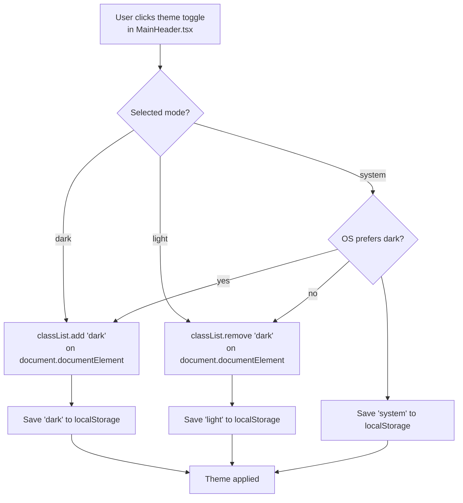
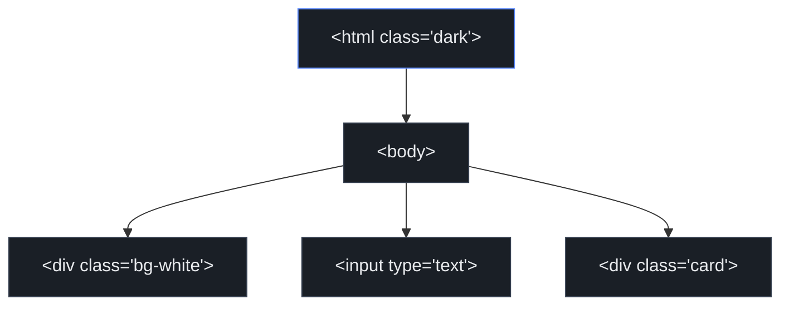
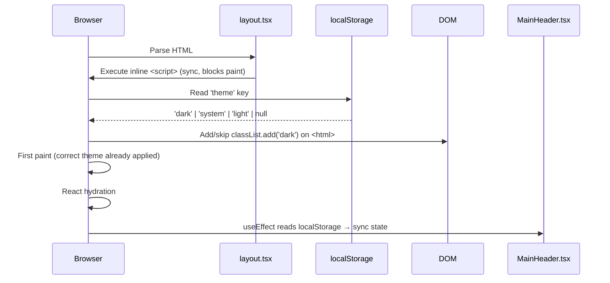
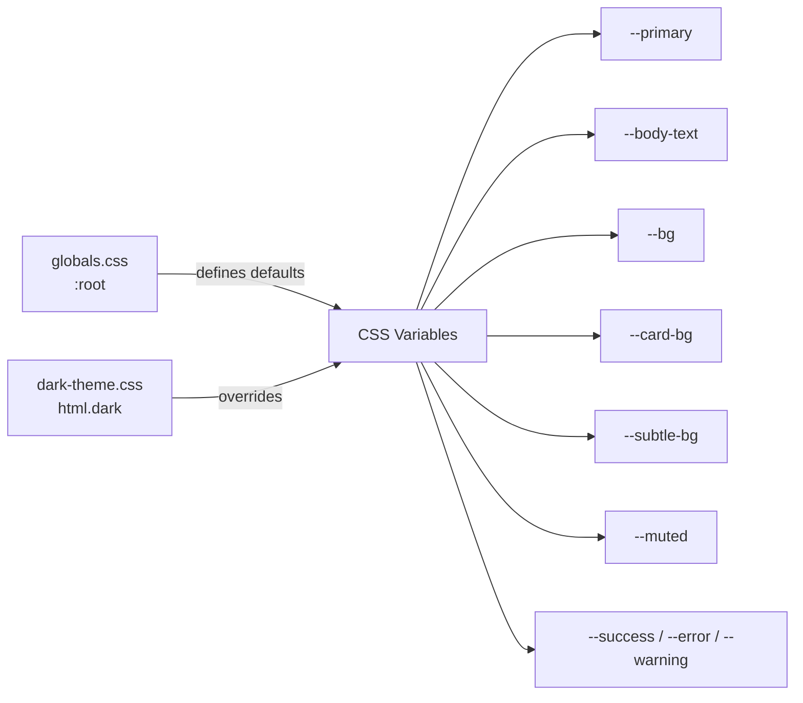
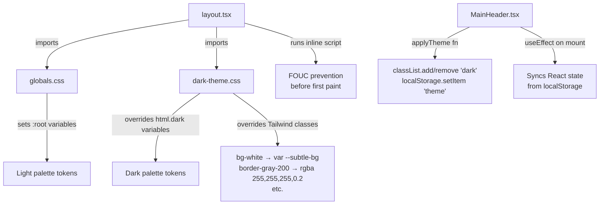
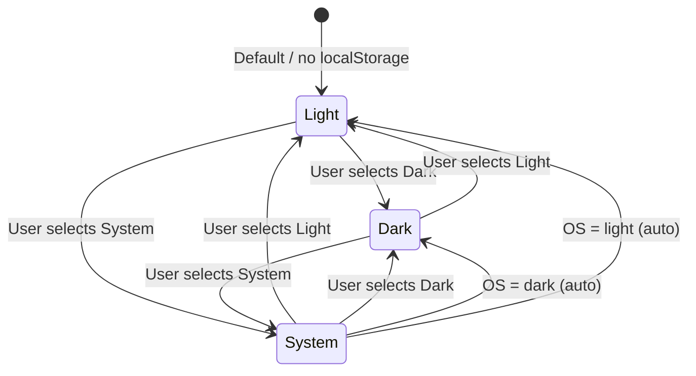

# Dark Mode Implementation

## Overview

Dark mode uses a **centralized CSS variable approach** instead of per-component Tailwind `dark:` utilities. Since all components in the system share the same color scheme, all dark mode overrides live in a single file (`dark-theme.css`) scoped to the `html.dark` class.

---

## Architecture



---

## How `html.dark` Works

The `.dark` class is added to the `<html>` element at the root of the DOM. Because it's on the topmost element, all CSS rules scoped to `html.dark` cascade down to every child element on the page — no component-level changes needed.



`dark-theme.css` overrides the light-mode Tailwind classes centrally:

```css
/* dark-theme.css — all scoped to html.dark */
html.dark .bg-white,
html.dark .bg-gray-50,
html.dark .bg-gray-100 {
  background-color: var(--subtle-bg) !important;
  color: var(--body-text) !important;
}
```

---

## Initialization Flow (FOUC Prevention)

A critical concern with client-side theming is **Flash of Unstyled Content (FOUC)** — the page briefly renders in the wrong theme before JavaScript runs.

This is solved by an inline `<script>` in `layout.tsx` that executes **synchronously before the first paint**:



The inline script (minified in `layout.tsx`):

```js
(function () {
  try {
    var t = localStorage.getItem('theme');
    if (t === 'dark') {
      document.documentElement.classList.add('dark');
    } else if (t === 'system') {
      if (window.matchMedia('(prefers-color-scheme: dark)').matches) {
        document.documentElement.classList.add('dark');
      }
    }
  } catch (e) {}
})();
```

---

## CSS Variable System

Two files split the color tokens by theme:

| File | Scope | Purpose |
|------|-------|---------|
| `globals.css` | `:root` | Light mode defaults |
| `dark-theme.css` | `html.dark` | Dark mode overrides |



### Color Tokens

| Token | Light | Dark | Used For |
|-------|-------|------|----------|
| `--primary` | `#355FD0` | `#5B8AFF` | Brand blue, buttons, links |
| `--primary-yellow` | `#FFC008` | `#FFB800` | Secondary accent |
| `--success` | `#65C979` | `#5FE07D` | Success states |
| `--error` | `#D86841` | `#FF8B6B` | Error/danger states |
| `--warning` | `#EAC645` | `#FFD666` | Warning states |
| `--bg` | `#FFFFFF` | `#0F1419` | Page background |
| `--body-text` | `#2C3F58` | `#E8EAED` | Primary text |
| `--card-bg` | `#FFFFFF` | `#1A1F26` | Cards, elevated surfaces |
| `--subtle-bg` | `#F9FBFC` | `#1A1F26` | Inputs, filters, subtle areas |
| `--muted` | `#6B7280` | `#9CA3AF` | Secondary/muted text |

---

## File Responsibilities



---

## What `dark-theme.css` Covers

The file overrides every major UI surface area when `html.dark` is active:

| Section | What it overrides |
|---------|-------------------|
| CSS Variables | All color tokens remapped to dark palette |
| Base | `body` background + text color |
| Backgrounds | `bg-white`, `bg-gray-50/100/200`, `bg-white/70-95` |
| Borders | `border`, `border-gray-200/300`, `border-b` |
| Form Controls | `input`, `textarea`, `select`, placeholders |
| Toggle Switches | Peer-based iOS toggle light/checked/focus states |
| Scrollbars | Track, thumb, hover colors |
| ReactQuill Editor | Toolbar, editor area, picker dropdowns |
| SVG Icons | Hardcoded fill/stroke hex overrides |
| React Select | Control, menu, options, multi-value chips |
| Dropdowns | `.dropdown-menu`, `.menu` |
| Pagination | `.pagination-wrapper` and child elements |
| React Datepicker | Calendar, header, selected day |
| Status Colors | `bg-yellow-100`, `bg-green-100`, `bg-red-100`, etc. |
| Semantic Colors | `text-sky-600`, `text-green-600`, `text-red-600`, etc. |
| Hover States | `hover:bg-gray-100` and variants |

---

## Adding Dark Mode to Technical Components

For components that use hardcoded colors not covered by the global CSS (e.g. `CustomToast`, custom SVGs), use Tailwind's `dark:` modifier with CSS variables:

```tsx
// Reference CSS variables inside Tailwind's arbitrary value syntax
className="bg-white dark:bg-[var(--card-bg)]"
className="text-gray-900 dark:text-[var(--body-text)]"
className="border-gray-200 dark:border-[var(--muted)]"

// Or with static Tailwind dark colors
className="bg-white dark:bg-gray-800"
className="text-gray-700 dark:text-gray-300"
```

Both work simultaneously — when `html.dark` is present, both `dark-theme.css` overrides and `dark:` Tailwind utilities are active.

---

## Theme Toggle UI (MainHeader.tsx)

The user-facing toggle is a modal in `MainHeader.tsx` with three options: **Light**, **Dark**, **System**.



`applyTheme(mode)` in `MainHeader.tsx` (lines 225–239):
1. Updates React state (`setThemeMode`)
2. Persists to `localStorage`
3. Adds or removes `dark` class on `document.documentElement`
4. For `'system'` mode, reads OS preference via `window.matchMedia`
